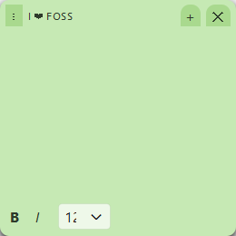

# Trozovka Notes

A Windows desktop app for frameless, always-on-top sticky notes — they float
above every other window, like the built-in Windows Sticky Notes, but with
richer text formatting: an explicit font-size dropdown (10–72) alongside
Bold and Italic. Built as a personal tool after none of the existing
open-source alternatives combined a redistributable license with that
feature set — see [Design notes](#design-notes) for what was evaluated and
why this wasn't forked from any of them.



## Tech stack

- **Python 3.12 + PySide6 (Qt)** — chosen over WPF/C# for consistency with
  the rest of this author's projects, and over Tkinter for far easier
  rich-text (`QTextEdit`) and modern styling support.
- No database, no cloud sync, no account, no Docker — notes are stored in a
  local `notes_data.json` (source runs) or `%LOCALAPPDATA%\Trozovka Notes\`
  (packaged `.exe`).

**Why this must run as a native Windows process:** "always on top of any
app" is an OS-level window property. A Linux GUI app (even via WSLg) can
only float above other Linux windows — it cannot overlay native Windows
applications. This app must be run with a **Windows** Python interpreter,
even if the source lives on WSL.

## Setup & run

Two ways to run it — **use the download if you just want to see it
working**; use source if you want to read or modify the code.

### Option A: Download (recommended for just trying it out)

Grab `Trozovka Notes.exe` from the [latest release](https://github.com/Trozovka/Trozovka-Notes/releases/latest)
and double-click it — no Python install required.

It's an unsigned executable, so on first run Windows SmartScreen may show
"Windows protected your PC." Click **More info → Run anyway** to launch it.

### Option B: Run from source

Requires Python 3.12+ **installed on Windows** (not inside WSL/Linux — see
"Tech stack" above).

```
git clone https://github.com/Trozovka/Trozovka-Notes.git
cd Trozovka-Notes
pip install -r requirements.txt
python main.py
```

To build your own `.exe` instead of downloading the release, run
`build-exe.ps1` — output lands in `dist\Trozovka Notes.exe`.

Either way, the app has no window chrome in the taskbar by design (it's a
floating utility, like the real Sticky Notes) — use the tray icon in the
notification area to create new notes or bring all notes to the front.

### Desktop shortcut

Run `create-desktop-shortcut.ps1` once from Windows PowerShell to add a
"Trozovka Notes" icon to the Desktop — double-click it to launch the app.
`remove-desktop-shortcut.ps1` deletes it again.

This is launch-on-demand only, by design: an earlier version of this script
registered the app to auto-launch at Windows login via the Startup folder,
but Bitdefender's behavior blocker flagged that as malicious persistence
and shut down the app along with everything else running alongside it
(including WSL). A plain Desktop shortcut avoids that entirely.

## Features

- Multiple independent note windows — frameless, rounded, draggable, and
  resizable from any edge or corner
- Always-on-top: notes float above any other Windows application
- Rich text formatting: **Bold**, *Italic*, and a font-size dropdown (10–72)
- Color picker with 7 note colors (yellow, green, pink, purple, blue, gray, charcoal)
- Autosave: content, formatting, position, size, and color persist locally and reload on relaunch
- System tray icon: new note, show all notes, quit

## Design notes

Before writing any code, existing open-source sticky-note projects were
searched and evaluated:

| Project | Why it wasn't forked |
|---|---|
| PaperTodo (WPF, 1.4k★) | Feature-rich (font/size/bold/colors) but licensed under PolyForm Noncommercial — not a redistributable open-source license |
| PinnyNotes (WPF, GPL-2.0) | Real always-on-top implementation, but a plain-text power-user tool with no bold/italic/font-size formatting |
| li-zheng-hao/StickyNotes (MIT) | Abandoned since 2023 |
| NoteBot | No LICENSE file at all |
| Playork/StickyNotes | Web app (Vue) — can't achieve OS-level always-on-top |

None were both properly open-source and a close feature match, so this was
built independently. PinnyNotes' `Topmost` window approach informed the
general architecture (not its code).

## License

MIT — see [LICENSE](LICENSE).
